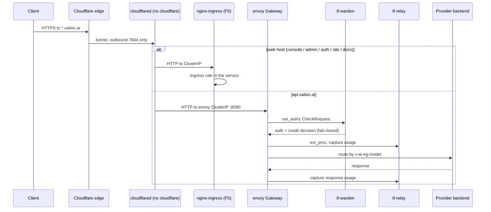
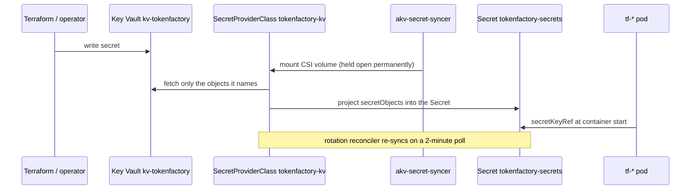
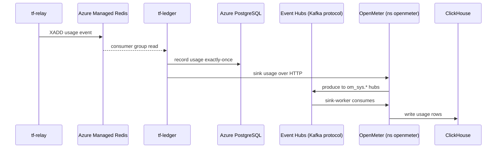
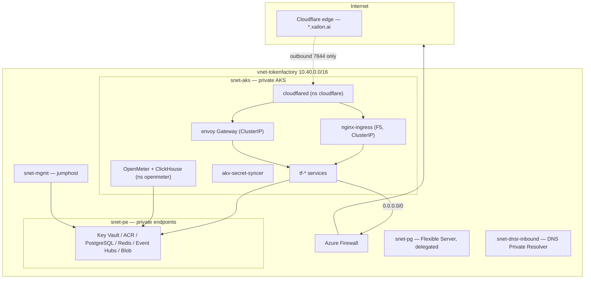

# Xailon TokenFactory — Azure Deployment
## Low-Level Design

| | |
|---|---|
| **Document** | Low-Level Design |
| **Product** | Xailon TokenFactory — AI Gateway Platform on Azure |
| **Namespace (primary deployment)** | `xailon-tf-prod` |
| **Application repository** | `github.com/Infinia-Technology/ai-gateway-platform` |
| **Infrastructure repository** | `github.com/Infinia-Technology/azure-infra-terraform` |
| **Branch** | `main` |
| **Chart overlay** | `helm/tokenfactory/values-xailon-prod.yaml` |
| **Helm release** | `tokenfactory` |
| **Image tag observed in cluster** | `0.16.2-e1bd218` |
| **Cluster** | `aks-tokenfactory` (private AKS, UAE North) |
| **Author** | Sidhant Khanna |
| **Date** | 2026-10-15 |
| **Status** | Draft |

---

## Table of Contents

1. [Document History](#1-document-history)
2. [Introduction](#2-introduction)
3. [System Architecture Details](#3-system-architecture-details)
4. [Detailed Module Designs](#4-detailed-module-designs)
5. [Detailed Interface & API Specifications](#5-detailed-interface--api-specifications)
6. [Database & Storage Design](#6-database--storage-design)
7. [Detailed Network Architecture](#7-detailed-network-architecture)
8. [Detailed Security Implementation Details](#8-detailed-security-implementation-details)
9. [Detailed Deployment & Configuration](#9-detailed-deployment--configuration)
10. [Detailed Operations & Maintenance Plans](#10-detailed-operations--maintenance-plans)
11. [Testing & Validation](#11-testing--validation)
12. [Implementation Roadmap & Phasing](#12-implementation-roadmap--phasing)
13. [Appendices](#13-appendices)

---

## 1 Document History

### 1.1 Document Location

This controlled document is stored as `XAILON-TOKENFACTORY-LLD.md`. It is the Azure-deployment
counterpart to the platform LLD (`docs/design/TOKENFACTORY-LLD.md`) in the application repository.

### 1.2 Revision History

| Revision | Date | Author | Summary of Change |
|---|---|---|---|
| 0.1 | 2026-10-15 | Sidhant Khanna | Initial LLD for the Xailon deployment, authored from the `values-xailon-prod.yaml` overlay, the umbrella chart on `main`, the Terraform configuration at `417dc58`, and the live `xailon-tf-prod` deployment on `aks-tokenfactory`. Follows the structure of the platform LLD. |
| 0.2 | 2026-10-15 | Sidhant Khanna | Adds the partner site-to-site VPN and the isolated collector subnet (section 7.6), the collector workloads (section 3.1.2), the DNS resolver and collector egress controls, and the verification evidence. Companion document renamed to `XAILON-OVERVIEW.md`. |

### 1.3 Document Approvers

| Name | Title |
|---|---|
| (to be confirmed) | (to be confirmed) |

---

## 2 Introduction

### 2.1 Purpose of the LLD

This Low-Level Design describes **how the TokenFactory platform is implemented on Azure for
Xailon**. The application code is unchanged from the platform baseline; what differs is every
layer beneath and around it — managed data services in place of bundled ones, Azure Key Vault in
place of HashiCorp Vault, a private cluster with no public ingress, and a Cloudflare Tunnel in
place of a load balancer.

It is the engineering reference for operating and extending this specific deployment.

### 2.2 Relationship to Other Documents

Three documents divide the space and should be read together:

| Document | Covers |
|---|---|
| TokenFactory HLD / LLD | The platform itself — services, filters, money pipeline, APIs. Environment-agnostic. |
| Xailon DevOps Overview (`XAILON-OVERVIEW.md`) | The end-to-end lifecycle — development, build, CD, Kubernetes, operations. The Azure infrastructure is summarised there, not detailed. |
| **This document** | The deployment in between: how the platform is configured, wired and run on that infrastructure. |

Where the platform LLD states what a service does, this document states how it is configured here
and where this deployment deviates. Only the deltas are described in depth; unchanged platform
behaviour is referenced rather than repeated.

### 2.3 Overview of the Xailon Deployment

**Xailon TokenFactory** is the TokenFactory AI Gateway running as a single production environment
on Azure in UAE North. It is the same multi-tenant, OpenAI-compatible gateway, deployed with:

- **Compute** — AKS `aks-tokenfactory`, **private cluster** (no public API server), CNI Overlay
  with Cilium, `outbound_type = userDefinedRouting`, two node pools.
- **Data** — Azure Database for PostgreSQL Flexible Server, Azure Managed Redis, Azure Event Hubs
  (Kafka protocol), Azure Container Registry, two storage accounts. All private-endpoint only.
- **Identity & secrets** — Keycloak in-cluster; Azure Key Vault as the secret store, projected
  into the cluster by the AKS Key Vault Secrets Provider.
- **Ingress** — no public load balancer. Inbound traffic arrives through a Cloudflare Tunnel whose
  connector runs in-cluster and dials **outbound** only.
- **Egress** — every subnet routes `0.0.0.0/0` to Azure Firewall; nothing leaves without an
  explicit allow-list rule.

### 2.4 Document Organization & Conventions

- Sections mirror the platform LLD so the two can be read side by side.
- Facts are stated with the file that carries them, so each can be checked.
- Where something is **not implemented**, **not tested**, or **blocked**, it is labelled as such
  rather than described as if it existed.
- Hostnames use the `*.xailon.ai` zone throughout.

### 2.5 Reference Documents & Standards

| Document | Source |
|---|---|
| TokenFactory HLD | `docs/design/TOKENFACTORY-HLD.md` |
| TokenFactory LLD (platform) | `docs/design/TOKENFACTORY-LLD.md` |
| Xailon DevOps Overview | `XAILON-OVERVIEW.md` |
| Chart configuration reference | `helm/tokenfactory/CONFIGURATION.md` |
| Xailon environment overlay | `helm/tokenfactory/values-xailon-prod.yaml` |
| Jumphost operations scripts | `~/xalion` on the jumphost |

---

## 3 System Architecture Details

### 3.1 Detailed System Overview

#### 3.1.1 What Changes From the Platform Baseline

| Concern | Platform baseline | Xailon on Azure |
|---|---|---|
| PostgreSQL | Bundled, in-cluster | **Azure Flexible Server**, external, ZoneRedundant HA |
| Redis | Bundled single pod | **Azure Managed Redis**, external, port **10000**, `NoCluster` |
| Secrets | HashiCorp Vault | **Azure Key Vault** via CSI driver → `tokenfactory-secrets` |
| Metering transport | Bundled Kafka | **Azure Event Hubs** (Kafka protocol) |
| Images | ghcr.io | **ACR** `acrtokenfactory.azurecr.io`, imported server-side |
| Ingress | `envoy` Service type LoadBalancer | **ClusterIP only** + Cloudflare Tunnel |
| Web routing | — | **F5 NGINX Ingress Controller** (`nginx.org/*` annotations) |
| Cluster API | Public | **Private**; all operations from a jumphost |
| GitOps | External Argo | **Argo CD in-cluster**, manual sync only |
| Observability | Prometheus / Grafana | **Not deployed** — disabled for cost |

#### 3.1.2 Core Components Breakdown

Deployments observed in `xailon-tf-prod`:

| Component | Kind | Replicas | Notes |
|---|---|---|---|
| `envoy` Gateway | Data plane | 6 | Service **ClusterIP**, not LoadBalancer |
| `tf-warden` | ext_authz filter | 3 | fail-closed auth/credit gate |
| `tf-relay` | ext_proc filter | 3 | usage extraction + metering |
| `tf-shim` | transform | 3 | special paths (video, rerank) |
| `tf-babel` | dialect proxy | 3 | Anthropic `/v1/messages` |
| `tf-auth` | Control plane | 3 | Keycloak-native identity boundary |
| `tf-accounts` | Control plane | 3 | orgs/projects/keys/billing |
| `tf-control` | Control plane | 3 | catalog + EAGW reconciliation |
| `tf-ledger` | Control plane | **1 — pinned** | see 4.2.1 |
| `tf-ops` | Control plane | 3 | read-only operator status |
| `tf-portal-web` | Web | 3 | tenant portal |
| `tf-admin-web` | Web | 3 | operator portal |
| `tf-site-web` | Web | 1 | public site |
| `tf-docs-web` | Web | 1 | public docs |
| `keycloak` | State (StatefulSet) | 3 | Infinispan cluster |
| `openfga` | State | 1 | `--datastore-engine=memory` |
| `minio` | State | 1 | object store for exports |
| `akv-secret-syncer` | Infrastructure | 1 | holds the Key Vault CSI mount open |

Outside the application namespace, in the isolated `snet-collector` subnet:

| Component | Count | Notes |
|---|---|---|
| Partner collector VMs | 2 | `10.40.5.5` / `10.40.5.6`, Ubuntu 24.04, one per availability zone |
| Collector load balancer | 1 | internal, virtual IP `10.40.5.4`, HA Ports |

These are **not** part of the platform. They belong to a second party, run no
TokenFactory component, and are isolated from every other resource — see
Partner Connectivity.

OpenMeter runs as a **separate Helm release in the `openmeter` namespace**, and `cloudflared` as a
separate deployment in the `cloudflare` namespace.

### 3.2 Detailed Data Flow Diagrams

#### 3.2.1 Inbound request path

There is **no public IP on any cluster service**. The only public addresses in the environment are
the Bastion, the Firewall and the VPN gateway, and all three are authenticated.

#### 3.2.2 Secret delivery

Two properties of this chain matter operationally and are covered in 8.2: the SecretProviderClass
is the entire list of what the cluster fetches, and the Secret is owned by the syncer's ReplicaSet.

#### 3.2.3 Metering through Event Hubs

### 3.3 Communication & Integration Mechanisms

| Mechanism | Protocol | Direction | Notes |
|---|---|---|---|
| Cloudflare Tunnel | HTTP/2 over TCP 7844 | connector → edge, **outbound only** | Hostname routing lives in the Cloudflare dashboard, not the cluster |
| Data-plane filters | gRPC | Gateway ↔ filters | Unchanged from platform |
| PostgreSQL | TCP 5432, `sslMode: require` | services → Flexible Server | Private endpoint |
| Redis | TCP **10000** | services → Azure Managed Redis | Non-standard port; plaintext inside the VNet |
| Event Hubs | Kafka, SASL_SSL `$ConnectionString` | OpenMeter ↔ Event Hubs | Replaces bundled Kafka |
| Key Vault | HTTPS via private endpoint | CSI driver → vault | Node managed identity |
| Container images | HTTPS via private endpoint | kubelet → ACR | Images imported server-side |
| Egress to providers | HTTPS via Azure Firewall | pods → internet | Allow-list only |

---

## 4 Detailed Module Designs

Module behaviour is as described in the platform LLD. This section records only what is
configured differently here, and the deployment-specific constraints.

### 4.1 Data-Plane Configuration

- **`envoy` at 6 replicas**, Service type **ClusterIP**. The platform default of LoadBalancer is
  deliberately not used: on AKS it provisions a public IP, and `userDefinedRouting` does not
  prevent that.
- `tf-warden`, `tf-relay`, `tf-shim`, `tf-babel` all at 3 replicas, matching the platform
  production posture.

### 4.2 Control-Plane Deviations

#### 4.2.1 tf-ledger is pinned to one replica

`tf-ledger` runs at **1 replica**, deliberately, while every other service runs 3. The overlay
records the reason: `cmd/tf-ledger/main.go` starts five unguarded `time.NewTicker` loops — pricing
refresh, consumer trim, reconciler, fast reconciler and customer sync — plus the DLQ replayer,
which holds only an in-process mutex.

There is **no leader election**: `tf-ledger`'s `go.mod` has no `k8s.io/client-go`, and the subchart
ships no Lease or RBAC for one. The one cluster-wide guard that exists, the `pg_advisory_lock` in
`store.Postgres.AcquireReplayLock`, covers only `reconcile.ReplayRebuild`, reached from an admin
endpoint — not from any of those loops.

**Do not raise this replica count without adding leader election first.** The bug was already hit
once at `replicas: 2` and fixed in PR #173.

#### 4.2.2 tf-auth needs an explicit Redis host

`tf-auth` requires `tf-auth.config.rateLimit.redis.{host,port}` to be set explicitly in the
overlay. The subchart's `workload.yaml:396` reads `global.redis.host` and never consults
`global.redis.external.host`, while `global.redis.port` stays `6379` in external mode. Without
both values **tf-auth is fatal at startup** — this caused a CrashLoopBackOff on 11 October 2026.

This is a chart defect worked around in the overlay. The fix belongs in the subchart.

#### 4.2.3 OpenFGA runs in memory

OpenFGA is deployed with `--datastore-engine=memory`. An `openfga` PostgreSQL database exists but
nothing uses it, and no `openfga` database role is created. Authorization state therefore does not
survive a pod restart.

### 4.3 Web Portals

`tf-portal-web`, `tf-admin-web`, `tf-site-web` and `tf-docs-web` are reached through the F5 NGINX
Ingress Controller rather than directly. The Ingress annotations are all `nginx.org/*`; the
community `ingress-nginx` controller would ignore them **silently**, including the
`proxy-buffer-size` pair that fixes the OIDC callback 502.

---

## 5 Detailed Interface & API Specifications

### 5.1 URL Map

| Public host | Path | Route | Backend |
|---|---|---|---|
| `https://api.xailon.ai` | `/v1/*` | tunnel → **envoy** directly | data plane |
| `https://console.xailon.ai` | `/*` | tunnel → nginx-ingress | `tf-portal-web` |
| `https://admin.xailon.ai` | `/*` | tunnel → nginx-ingress | `tf-admin-web` |
| `https://auth.xailon.ai` | `/*` | tunnel → nginx-ingress | `tf-auth` + Keycloak |
| `https://xailon.ai` | `/*` | tunnel → nginx-ingress | `tf-site-web` |
| `https://argo.xailon.ai` | `/*` | tunnel → Argo CD | Argo CD server |

`api.xailon.ai` bypasses the ingress controller and reaches `envoy` directly. The other hosts go
through nginx. Hostname-to-service mapping is held in the **Cloudflare Zero Trust dashboard**, not
in any cluster object, and is therefore not version-controlled.

### 5.2 Data Models & Message Formats

Unchanged from the platform LLD. API keys are SHA-256 hashed; usage events carry an idempotent
event id; model references are `provider/model` public names resolved to `x-ai-eg-model`.

### 5.3 Interface Protocols & Security

As per the platform LLD, with two substitutions: secrets come from **Azure Key Vault** rather than
HashiCorp Vault, and TLS terminates at the **Cloudflare edge** — the tunnel-to-cluster hop is
plaintext HTTP inside the VNet, which is why Argo CD runs with `server.insecure: true`.

### 5.4 Error Codes

Unchanged from the platform LLD. Two deployment-specific symptoms are worth recording:

| Symptom | Cause specific to this deployment |
|---|---|
| Application timeout calling an external service | FQDN missing from the Azure Firewall allow-list. Fails as a timeout, not a network error. |
| `CROSSSLOT` from multi-key Redis scripts | Azure Managed Redis with `EnterpriseCluster` shards keys. See 6.3. |

---

## 6 Database & Storage Design

### 6.1 PostgreSQL — Azure Flexible Server

| Property | Value |
|---|---|
| Server | `psql-tokenfactory.postgres.database.azure.com` |
| Version | PostgreSQL 16 |
| SKU | `GP_Standard_D8ds_v5`, 128 GB auto-grow |
| HA | **ZoneRedundant** (primary zone 1, standby zone 2) |
| Backup | 30-day, **geo-redundant** |
| Access | Private endpoint only, `sslMode: require` |
| Databases | `tokenfactory`, `keycloak`, `openmeter`, `svix`, `openfga` |

Four roles exist — `tokenfactory`, `keycloak`, `openmeter`, `svix` — each owning its own database
**and its `public` schema**. The schema ownership is not optional: on PostgreSQL 15 and later a
non-owner cannot create objects in `public`, and migrations fail with
`permission denied for schema public`.

Role passwords are never typed by hand; they are read from Key Vault, which is also where the
syncer takes them from, so the two can never diverge.

`azure.extensions` must list every extension the migrations need. An empty allow-list caused
`tf-accounts` migration 1 to fail, presenting as a dirty-migration error rather than a permission
error.

### 6.2 Migration tracking

The `tokenfactory` database carries **two** independent tracking tables:

| Table | Written by |
|---|---|
| `platform_schema_migrations` | `tf-accounts` and `tf-auth`, via the `db-migrate` initContainer |
| `tf_ledger_schema_migrations` | `tf-ledger`, embedded in the main container |

Every replica runs migrations at startup, and `golang-migrate` marks `dirty` **before** applying
SQL. If a pod dies mid-migration the flag is left set and every other pod exits on sight of it, so
the real error is never logged.

**Clearing the dirty flag is the wrong recovery.** It makes `golang-migrate` treat the migration as
applied without running it, which silently skips schema. The correct recovery is `force <N-1>` and
re-run. Jumphost scripts exist for serialising this safely.

### 6.3 Redis — Azure Managed Redis

| Property | Value |
|---|---|
| Resource | `redis-tokenfactory`, Azure Managed Redis `Balanced_B10` (12 GB) |
| Endpoint | `redis-tokenfactory.uaenorth.redis.azure.net:10000` |
| Clustering policy | **`NoCluster`** |
| Eviction | `NoEviction` |
| Persistence | none |
| Provisioned by | `azapi`, not `azurerm` |

**`clusteringPolicy` must be `NoCluster`.** `EnterpriseCluster` presents a single endpoint but
still shards keys, and `tf-ledger`'s multi-key credit scripts then fail with `CROSSSLOT` — hit in
production on 11 October 2026, which forced a revert.

Moving to `EnterpriseCluster` later is possible but **order-dependent**: ship hash tags in
`tf-ledger` and `tf-warden` with the key-layout migration first, verify on `NoCluster`, and only
then change the policy. On that change `terraform plan` must say *update in place*; a
*destroy and then create replacement* line is a stop.

Redis holds hot-path counters and the usage stream. It has no persistence and is rebuildable from
PostgreSQL plus traffic.

### 6.4 Event Hubs

`ehns-tokenfactory`, Standard tier (the Kafka protocol requires Standard or above), private
endpoint only. Seven hubs matching OpenMeter's topics, including three DLQs with Capture enabled to
the archive storage account.

Capture requires the **caller** to hold data-plane blob write on that account — control-plane Owner
or Contributor does not satisfy it. That is why a `Storage Blob Data Owner` assignment exists, with
a propagation wait before the hubs are created.

### 6.5 Object storage

| Store | Purpose |
|---|---|
| MinIO (in-cluster) | `tf-ledger` export archive |
| `sttokenfactoryarch001` | Event Hubs Capture target, LRS |
| `sttokenfactorytfstate001` | Terraform state, **ZRS**, versioning on |

### 6.6 Backup & Retention

| Data | Protection |
|---|---|
| PostgreSQL | 30-day geo-redundant automated backup |
| Terraform state | Blob versioning on a ZRS account |
| Event Hubs | 7-day retention plus Capture to blob |
| Key Vault | Soft delete 90 days, purge protection **on** |
| Redis | None — rebuildable |

**A restore has never been rehearsed.** Treat recovery times as unmeasured.

---

## 7 Detailed Network Architecture

### 7.1 Network diagram

### 7.2 Why there is no load balancer

Every cluster Service is **ClusterIP**. On AKS, `type: LoadBalancer` provisions a public IP, and
`outbound_type = userDefinedRouting` does not prevent it. The environment has exactly three public
IPs — Bastion, Firewall, VPN gateway — and all three are authenticated. A fourth would contradict
the design, and it is unnecessary because the tunnel connector reaches services from inside the
cluster over service DNS.

### 7.3 Segmentation

Eight subnets, with NSGs on the PostgreSQL, private-endpoint and AKS subnets, and a NIC-level NSG
on the jumphost. Every NSG ends with `Deny-VNet-Inbound` at priority 4096, so subnet-to-subnet
traffic is allow-listed rather than assumed.

Namespaces: `xailon-tf-prod` (application), `openmeter`, `cloudflare`, `nginx-ingress`, `argocd`.

A NetworkPolicy on the OpenMeter API admits only the application namespace. If that value is wrong,
`tf-ledger` is blocked and the symptom reads as "OpenMeter unreachable".

### 7.4 DNS

A DNS Private Resolver inbound endpoint holds a **static** address, which the VNet advertises as
its DNS server. Private DNS zones exist for Key Vault, ACR, PostgreSQL, Redis, blob and Service
Bus.

Use `getent hosts` to verify resolution, not `dig`: `dig` bypasses the OS resolver order and can
report success while the application path fails.

The Redis private DNS zone must be `privatelink.redis.azure.net`. Azure Cache for Redis
**Enterprise** uses `privatelink.redisenterprise.cache.azure.net`, the two products share one ARM
type, and Terraform accepts either — so the wrong zone applies cleanly and leaves the hostname
resolving to a public IP.

### 7.5 Egress

All pod egress leaves through Azure Firewall against an explicit allow-list. A missing FQDN
presents as an **application-level timeout**, not a network error — the failure mode that cost the
most diagnosis time in this environment. The Google SSO 502 traced to
`openidconnect.googleapis.com` being absent from the list, not to a bad secret.

Note that under CNI Overlay, pod egress is SNATed to the node IP, so firewall rules match on node
addresses rather than pod addresses.

---

### 7.6 Partner Connectivity — Site-to-Site VPN and the Collector Enclave

A second party (ZySec) operates two collector VMs inside this environment. They
reach those two hosts and nothing else. The design is an isolated enclave rather
than a set of denies bolted onto an existing subnet.

#### 7.6.1 The tunnel

| Property | Value |
|---|---|
| Gateway | `vgw-tokenfactory` — the **existing** gateway, reused |
| Our public endpoint | `20.233.3.250` (Static, Standard SKU) |
| Partner endpoint | `74.162.206.233` |
| Partner address space | `10.23.3.0/26` |
| Type | Route-based, IKEv2, single instance |
| Phase 1 | AES256 / SHA256 / DHGroup14 |
| Phase 2 | AES256 / SHA256 / PFS None, SA 86400 s, SA data 102400000 KB |

No second gateway and no new gateway subnet: site-to-site and the existing
point-to-site configuration coexist on one route-based gateway, which is why
`vpn_type` must remain `RouteBased`.

The pre-shared key is held in Key Vault as `s2s-shared-key` and read by a data
source at plan time. It never appears in the configuration.

**One parameter does not match the partner's specification.** They specified an
IPsec SA data size of `0`, meaning their device does not rekey on data volume.
Azure requires that field whenever a custom IPsec policy is set and does not
accept `0`, so it is `102400000` KB. The time-based rekey at 86400 s will
normally fire first, but the asymmetry is real and the partner has to accept it.

**No route was added for the partner CIDR.** Azure installs a system route for
the Local Network Gateway's address space, and route selection is
longest-prefix-match across all sources, so `/26` beats the `0.0.0.0/0` user
route to the firewall unaided. An explicit `azurerm_route` would also conflict
with `route_table.tf`'s inline `route` blocks, which are authoritative — the two
forms cannot manage the same table.

#### 7.6.2 The collector enclave

| Resource | Value |
|---|---|
| Subnet | `snet-collector` — `10.40.5.0/28` |
| Route table | `rt-collector`, `0.0.0.0/0` to the firewall |
| Virtual IP | `10.40.5.4`, internal Standard load balancer, zone-redundant |
| collector-01 | `10.40.5.5`, zone 1 |
| collector-02 | `10.40.5.6`, zone 2 |
| Specification | 8 vCPU, 16 GB, 100 GB Premium SSD, Ubuntu 24.04 LTS |

Addresses are **static**, because the partner configures against them. Neither
VM has a public IP.

**The virtual IP is a load balancer, not a floating address.** Keepalived and
VRRP do not fail over on Azure: the platform does not honour gratuitous ARP. The
rule uses **HA Ports** — `protocol = All`, frontend and backend port `0` — so
every port and protocol forwards to whichever collector passes the probe,
without needing to know the service port in advance. `load_distribution` is
`SourceIP` so a client stays pinned for the life of its flows, and
`enable_floating_ip` is required by HA Ports.

The health probe is TCP 22. It proves the VM is alive, not that the collector
service is healthy; `collector_probe_port` exists to be changed once the service
port is known.

#### 7.6.3 How the isolation is enforced

`nsg-collector` denies in **both** directions and opens only what is needed:

| Priority | Direction | Action | Scope |
|---|---|---|---|
| 100 | Inbound | Allow | SSH 22 from `AzureBastionSubnet` — operators |
| 110 | Inbound | Allow | `AzureLoadBalancer` — the probe, mandatory |
| 150 | Inbound | Allow | `10.40.5.0/28` — peer collector |
| 200 | Inbound | Allow | `10.23.3.0/26` — the partner, all ports |
| 4096 | Inbound | Deny | `VirtualNetwork` |
| 100 | Outbound | Allow | to `10.23.3.0/26` — return traffic |
| 150 | Outbound | Allow | to `10.40.5.0/28` — peer collector |
| 200 | Outbound | Deny | to `VirtualNetwork` |

Three properties make this hold, and the first is the one most easily got wrong:

1. **Azure's `VirtualNetwork` service tag expands to include address spaces
   declared on a Local Network Gateway.** The moment the tunnel exists,
   `10.23.3.0/26` becomes part of that tag. Every NSG in this environment uses
   `VirtualNetwork` only as a **deny** source and explicit CIDRs for every
   **allow** — so the expansion causes the existing denies to cover the partner,
   rather than silently granting access. An `Allow from VirtualNetwork` rule
   anywhere would have handed the partner that access on day one.

2. **The outbound deny is what prevents a pivot.** Inbound rules stop the partner
   reaching further in; only the outbound deny stops a compromised collector
   reaching AKS, PostgreSQL or Key Vault.

3. **Collector-to-collector needed rules in both directions.** An outbound allow
   alone fails, because the peer's traffic arrives with a source inside the
   subnet and `Deny-VNet-Inbound` at 4096 would drop it.

#### 7.6.4 Two supporting controls

**DNS.** `snet-dnsr-inbound` had no NSG, so the partner could have queried the
DNS Private Resolver and enumerated every private name in the environment.
`nsg-dnsr` adds a single deny for `10.23.3.0/26` — deliberately one deny rather
than an allow-list, because an allow-list here is the change most likely to break
cluster DNS if a source is missed.

**Egress.** The collectors route `0.0.0.0/0` to the firewall, so a firewall rule
collection `collector-os-updates` (priority 112) permits `10.40.5.0/28` to reach
`archive.ubuntu.com`, `security.ubuntu.com`, `azure.archive.ubuntu.com` and
`changelogs.ubuntu.com` only. **This is not yet working** — `apt` times out, and
because firewall logging is disabled the deny cannot be observed. See the
go-live blockers.

#### 7.6.5 Verification

Tested from inside `vm-collector-01` on 15 October 2026. Every one of these
failed to connect, which is the intended result:

| Target | Result |
|---|---|
| PostgreSQL `psql-tokenfactory…:5432` | blocked |
| Redis `redis-tokenfactory…:10000` | blocked |
| Key Vault `10.40.3.6:443` | blocked |
| ACR `10.40.3.4:443` | blocked |
| Event Hubs `10.40.3.7:443` | blocked |
| Jumphost `10.40.1.4:22` | blocked |
| AKS node `10.40.8.4:10250` | blocked |
| Peer collector `10.40.5.6:22` | **reachable**, as intended |

DNS resolution from the collector still succeeds while the connection is
blocked, which is the correct combination: the name resolves, the packet is
dropped.

---

## 8 Detailed Security Implementation Details

### 8.1 What is closed

| Surface | State |
|---|---|
| AKS API server | Private, no public FQDN |
| PostgreSQL, Redis, Key Vault, ACR, Event Hubs | `public_network_access_enabled = false`, private endpoint only |
| Cluster Services | ClusterIP only, no public IP |
| Inbound to the VNet | None — the tunnel dials outbound |
| Pod egress | Azure Firewall allow-list |
| Subnet-to-subnet | NSG allow-list, deny at 4096 |

### 8.2 Secrets

Key Vault `kv-tokenfactory` is in **RBAC mode**, purge protection on, 90-day soft delete, private
endpoint only. The AKS Key Vault Secrets Provider addon holds `Key Vault Secrets User`.

Three properties of the delivery chain are load-bearing:

1. **The SecretProviderClass is the entire list of what the cluster fetches.** A secret present in
   the vault but not named in `tokenfactory-kv` is never synced and raises no error anywhere. Both
   `spec.parameters.objects` and `spec.secretObjects[].data` must name it; an entry in the first
   without the second fetches the value to the tmpfs mount and writes nothing.
2. **`Deployment/akv-secret-syncer` must not be deleted.** It exists only to hold the CSI mount
   open, and `tokenfactory-secrets` is owner-referenced to its ReplicaSet. Deleting the Deployment
   garbage-collects the Secret, after which every `tf-*` pod fails with
   `CreateContainerConfigError` on its next restart. `rollout restart` is safe.
3. **The manifest is not version-controlled.** It exists only on the jumphost, which makes it the
   most load-bearing unversioned file in the environment.

Rotation is enabled on the addon with a 2-minute poll, so the Secret refreshes on its own. Pods do
not: environment variables are read once at process start, so a consumer restart is still required.

Key Vault provides custody and lifecycle, not secrecy from inside the cluster. The projected
Secret is plaintext in etcd and readable by any principal holding `get secrets` in the namespace.

### 8.3 Access

Operators reach the environment through the Point-to-Site VPN or Azure Bastion and land on the
jumphost. The jumphost's system-assigned managed identity exists **only** because the Entra SSH
extension requires one and is deliberately granted **no role at all**.

### 8.4 Known security gaps

| Gap | Consequence |
|---|---|
| `kube-audit` not enabled | A secret read in the namespace leaves no queryable trace |
| OpenFGA in memory | Authorization state does not survive a restart |
| Terraform principal holds Key Vault Administrator | Interactive and automation paths are not separated |

---

## 9 Detailed Deployment & Configuration

### 9.1 Environments

There is **one** environment. There is no Xailon staging, and nothing is promoted into or out of
this deployment.

| Environment | Namespace | Overlay |
|---|---|---|
| production | `xailon-tf-prod` | `values-xailon-prod.yaml` |

### 9.2 Installation sequence

1. **Infrastructure** — `terraform apply` from the jumphost against the remote state backend.
2. **Images** — import the 13 `tf-*` images and the infra images into ACR. `az acr import` runs
   **server-side**: nothing passes through the jumphost disk, and the firewall is not in the path,
   so sources blocked from inside the VNet still import.
3. **Secrets** — seed Key Vault, apply the SecretProviderClass and syncer, confirm
   `tokenfactory-secrets` is populated.
4. **Database** — create the four roles with Key Vault passwords and reassign `public` schema
   ownership.
5. **Ingress** — install the F5 NGINX Ingress Controller as ClusterIP.
6. **Tunnel** — deploy `cloudflared` in the `cloudflare` namespace with its own SecretProviderClass
   and syncer, because Secrets are namespace-scoped.
7. **OpenMeter** — install as a separate release in its own namespace, pointed at Azure PostgreSQL
   and Event Hubs. The release **must** be named `openmeter`, or `tf-ledger`'s `OPENMETER_URL` will
   not match and the provisioning hook stalls silently.
8. **Application** — `helm upgrade --install tokenfactory` with the Xailon overlay.

### 9.3 Configuration management

- Chart base `values.yaml` plus the `values-xailon-prod.yaml` overlay. The overlay is a **thin**
  one: it carries only what differs.
- The Helm release **must** be named `tokenfactory`. Six subcharts hardcode `<release>-secrets` and
  ignore `global.secretsName`, so a different release name cannot find `tokenfactory-secrets`.
- `requireImmutableTag: true` — the image tag is explicit and a dropped tag fails the render rather
  than silently falling back to the chart `appVersion`.
- Infra images read `global.imageRegistry`, not `global.image.registry`; both are set to ACR.

### 9.4 Argo CD

Argo CD v3.5.4 runs **inside** the cluster, because the AKS API server is private and has no
inbound path. The `xailon-tokenfactory` Application adopts the existing release and is **manual
sync only** — no `syncPolicy.automated`, and no cascading-delete finalizer.

Two differences it must carry: `releaseName` pinned to `tokenfactory`, and `ignoreDifferences` on
the `tf-auth-openmeter` token. The chart generates that token with `lookup` falling back to
`randAlphaNum`, and Argo's repo-server templates without cluster access, so `lookup` is always
empty and every refresh produces a new token — permanent OutOfSync plus a `tf-auth` restart on
every sync.

### 9.5 What is not automated

Roughly eight to ten post-apply steps are performed by scripts on the jumphost rather than by
Terraform or Helm: Key Vault seeding, the SecretProviderClass and syncer, PostgreSQL roles and
schema ownership, ACR imports, the ingress controller, the tunnel, OpenMeter, the TLS secret, and
Cloudflare DNS and tunnel configuration.

Those scripts are published to a separate repository but are not part of either the application or
the infrastructure repository, and the Cloudflare configuration exists only in the dashboard.

### 9.6 Rollback

- **Application** — `helm rollback`, or re-apply the previous pinned image tag. The chart's own
  checksum mechanism does **not** help here: with `global.secrets.existingSecret` set it resolves
  to an empty string, so a change to the external Secret is not detected and needs a manual
  rollout restart.
- **Infrastructure** — revert the commit and re-apply. This does not recover one-way doors.
- **Data** — PostgreSQL point-in-time restore within the 30-day window. Untested.

---

## 10 Detailed Operations & Maintenance Plans

### 10.1 Monitoring

**Neither observability stack is deployed.** Azure Monitor diagnostic settings and Log Analytics
exist in the configuration but are parked as `logging.tf.disabled`, and Managed Grafana as
`grafana.tf.disabled`. Both were disabled for cost.

The practical consequences:

- No alert rules, no dashboards, no on-call integration.
- **Firewall denies are invisible**, which is why a missing egress rule presents as an application
  timeout with nothing to correlate against.
- No queryable record of who read a secret.

Re-enabling is a `git mv` plus an apply. If only one category is restored, `kube-audit-admin` is
the cheaper and more useful half.

### 10.2 Health checks

| Check | Command | Expected |
|---|---|---|
| Private DNS | `getent hosts kv-tokenfactory.vault.azure.net` | a private address |
| Drift | `terraform plan` | *No changes* |
| Secret reached the cluster | byte count of the key in `tokenfactory-secrets` | non-zero |
| Keycloak cluster | `ISPN000094` in `keycloak-0` logs | 3 members |
| Migrations | `dirty` in both tracking tables | false |

### 10.3 Scaling

Capacity is changed by editing variables and applying. Two constraints: `tf-ledger` must stay at
one replica until leader election exists, and PostgreSQL storage only grows — its IOPS scale with
the allocated size, and the current 500 IOPS at 128 GB has not been validated against a load test.

### 10.4 Upgrades

- **Application** — import the new tag to ACR, set it in the overlay, `helm upgrade`. Everything
  goes through Helm; manual `kubectl scale` or `patch` changes are silently reverted on the next
  upgrade.
- **Kubernetes** — `kubernetes_version` in Terraform; node images do not update themselves.
- **Providers** — pinned with a committed lock file; upgrading is deliberate.

### 10.5 Action needed — Redis API version

The Redis **cluster** resource is still on API version `2025-04-01` while the **database** resource
is on `2025-07-01`. The split is deliberate: moving the cluster to `2025-07-01` makes `azapi`
require `properties.publicNetworkAccess`, which cannot be set on a cluster created under an older
version.

Reporting suggests Microsoft will retire `Microsoft.Cache/RedisEnterprise` API versions older than
`2025-07-01` from **31 October 2026**. That date appears in a Microsoft Q&A thread and a GitHub
issue quoting a Microsoft email and **could not be confirmed on an official retirement page**;
Azure Service Health advisories on the subscription are the authoritative source. If it holds, the
cluster has to be migrated, which is a planned change rather than a version bump.

---

## 11 Testing & Validation

### 11.1 What exists

Unit and integration tests are the platform's own, unchanged. The application-level E2E suite runs
against a live cluster.

### 11.2 What does not exist for this deployment

- **No CI for the infrastructure.** `terraform plan` needs VNet-internal execution, so a hosted
  runner cannot run it. Static checks — `fmt`, `validate`, `tflint` — do not need VNet access and
  are not configured either.
- No automated test that the Cloudflare routing matches the cluster, because that mapping lives
  outside the cluster.
- No load test. The PostgreSQL IOPS figure and the `tf-warden` sub-50 ms decision target are
  unvalidated here.
- No restore rehearsal.

### 11.3 Post-apply validation

1. `terraform plan` prints *No changes*.
2. `getent hosts` resolves Key Vault and PostgreSQL to private addresses.
3. `terraform state list` count matches the recorded figure.
4. If a secret changed, confirm it reached `tokenfactory-secrets` and restart its consumers.
5. External reachability of each public host returns the expected status.

---

## 12 Implementation Roadmap & Phasing

### 12.1 Current state

Infrastructure and platform are deployed and running. The environment is **not yet serving
production traffic**, and the remaining work is configuration and hardening rather than
architecture.

### 12.2 Go-live blockers

| # | Blocker | Note |
|---|---|---|
| 1 | **Stripe is not configured** | `stripe-secret-key` is absent from Key Vault and the webhook secret holds the chart's inert placeholder. Checkout, top-up and webhooks are all inactive. The publishable key in the overlay also still points at the previous environment's account. |
| 2 | **Collector OS updates fail** | The collector subnet routes egress through the firewall and the Ubuntu archive rule is not matching, so `apt` times out. Firewall logging is disabled, so the deny is not visible. |
| 3 | **Partner SSH access undefined** | The collector VMs carry only the operator key and password authentication is disabled, so the partner cannot authenticate. Their public keys or an agreed access method are needed. |

### 12.3 Hardening backlog

| Item | Why |
|---|---|
| Re-enable `kube-audit-admin` | No record of secret access today |
| Separate the Terraform principal from interactive logins | Reaching the jumphost should not confer Key Vault Administrator |
| Version-control the SecretProviderClass and the post-apply scripts | Single copies on one VM |
| Fix the `tf-auth` Redis host defect in the subchart | Remove the overlay workaround |
| Add leader election to `tf-ledger` | Unblock replicas above 1 |
| Move OpenFGA to its PostgreSQL database | Authorization state currently does not survive a restart |
| Resolve the Redis API-version retirement | See 10.5 |
| Rehearse a PostgreSQL restore | Recovery time is unmeasured |

### 12.4 Future enhancements

Redis hash tags plus the key-layout migration, enabling `EnterpriseCluster` in the stated order;
Workload Identity in place of the node managed identity for secret access; observability restored
once the cost decision is revisited.

---

## 13 Appendices

### 13.1 Glossary

Platform terms are in the TokenFactory HLD glossary. Azure-specific terms used here:

| Term | Meaning |
|---|---|
| AMR | Azure Managed Redis |
| CSI driver | AKS Key Vault Secrets Provider, projects vault secrets into pods |
| SecretProviderClass | The manifest naming which vault secrets the cluster fetches |
| UDR | User-defined routing; forces egress through the firewall |
| Private endpoint | Private IP in the VNet for a PaaS service |
| Capture | Event Hubs feature archiving events to blob storage |
| One-way door | A setting that cannot be reverted by reverting the code |

### 13.2 Revision History

| Revision | Date | Author | Change |
|---|---|---|---|
| 0.1 | 2026-10-15 | Sidhant Khanna | Initial LLD for the Xailon Azure deployment. |
| 0.2 | 2026-10-15 | Sidhant Khanna | Partner site-to-site VPN, collector subnet and verification evidence. |

### 13.3 Contact Information

| Role | Contact |
|---|---|
| Platform architecture | (to be confirmed) |
| DevOps | (to be confirmed) |
| Security | (to be confirmed) |

### 13.4 Reference Documents

| Reference | Location |
|---|---|
| TokenFactory HLD / LLD | `docs/design/` in the application repository |
| Xailon DevOps Overview | `XAILON-OVERVIEW.md` |
| Chart configuration reference | `helm/tokenfactory/CONFIGURATION.md` |
| Xailon overlay | `helm/tokenfactory/values-xailon-prod.yaml` |
| Jumphost operations scripts | `~/xalion` |

### 13.5 Additional Diagrams

- Inbound request path, secret delivery and metering sequence diagrams (3.2).
- Network diagram (7.1).

---

## Final Notes

This LLD is grounded in the `values-xailon-prod.yaml` overlay, the umbrella chart on `main`, the
Terraform configuration at `417dc58`, and the live `xailon-tf-prod` deployment. Where a control is
absent, untested or blocked it is stated as such rather than described as if it existed — in
particular the empty catalog, the unconfigured Stripe integration, the disabled observability
stack, and the untested restore and rebuild paths.

The deliberate deviations from the platform defaults — `tf-ledger` at one replica, `NoCluster` on
Redis, ClusterIP Services, OpenFGA in memory, the explicit `tf-auth` Redis host — each exist for a
recorded reason. None should be changed without reading the reason first.

---

**End of Document**
